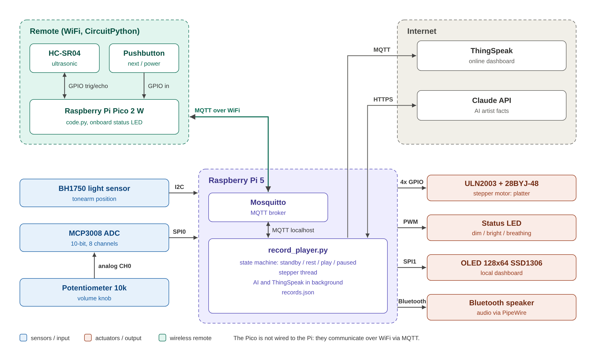

# Team Project Report: Smart Record Player

IoT Essentials 2026 · Team: Maarten Wils, Robin Wils

> Draft. Everything between [square brackets] still has to be filled in after testing.

**YouTube demo:** [link]
**Code:** https://github.com/maarten-wils/iot-smart-record-player

---

## 1. Team composition and responsibilities

| Role | Responsible | Tasks |
| --- | --- | --- |
| Team leader | [name] | contact with the coaches, final upload on Canvas |
| Documentation | [name] | report, video |
| Hardware | [name] | physical setup, LEGO record player and remote |
| Software | [name] | program structure, inline comments |

| Part | Built by |
| --- | --- |
| Record player prototype: stepper, BH1750, PWM LED, OLED, audio | Maarten |
| Pico remote + MQTT, MCP3008 volume knob, ThingSpeak, AI facts, main application | Robin |

## 2. Concept

A small smart record player. Placing the LEGO tonearm on the record starts the platter,
the music and the status display. A wireless remote pauses the music with a hand gesture,
selects the next record and puts the player in standby. The status is shown on an OLED,
on the remote and on an online dashboard. For every record an AI model shows a fun fact
about the artist.

## 3. IoT Information-Value Loop

| Stage | In our project |
| --- | --- |
| Create | BH1750 (tonearm position), potentiometer via MCP3008 (volume), HC-SR04 and pushbutton on the Pico |
| Communicate | MQTT over WiFi (Pico <-> Mosquitto on the Pi), MQTT to ThingSpeak, HTTPS to the Claude API |
| Aggregate | the Pi combines tonearm position, remote commands and volume into one player state |
| Analyze | state machine STANDBY / REST / PLAY / PAUSED; AI generates a fact about the artist |
| Act | stepper platter, PWM LED, audio, OLED, LED on the remote, ThingSpeak dashboard |

## 4. Block schematic

## 5. Setup

[photo of the complete setup]
[photo of the remote]

### Raspberry Pi 5

- **BH1750 (I2C1, address 0x23):** the LEGO tonearm covers the sensor on its rest.
  Below [4] lux = REST, above = PLAY.
- **28BYJ-48 + ULN2003 (4x GPIO):** wave drive, 10 ms per step. The motor runs in its own
  thread, so the platter turns smoothly while the rest of the program works.
- **PWM LED (GPIO12):** dim in REST, bright in PLAY, a sine "breathing" in PAUSED, off in standby.
- **OLED SSD1306 (SPI1):** status, volume, artist, title and the AI fact (in pages of two lines).
- **MCP3008 (SPI0, CS on GPIO25) + 10k potentiometer on CH0:** volume knob, 0 - 100 %,
  with a 3 % deadband against noise. The volume is set with `wpctl` on the PipeWire output.
- **Bluetooth speaker:** `pw-play` plays the audio file of the selected record.
  Pause and resume freeze and continue the playback process (SIGSTOP / SIGCONT).
- **Mosquitto:** local MQTT broker.

### Pico 2 W remote

- **HC-SR04 (GP2 trig, GP3 echo via a 1k / 2k voltage divider):** a hand closer than 10 cm
  for 1 s sends `TOGGLE`. Hysteresis (re-arm above 15 cm) prevents repeated commands.
- **Pushbutton (GP15, internal pull-up):** short press = `NEXT`, long press (1.5 s) = `POWER`.
- **Onboard LED:** on = PLAY, blinking = PAUSED, off otherwise (status received over MQTT).

### MQTT topics

| Topic | Direction | Payload |
| --- | --- | --- |
| `recordplayer/remote/command` | Pico -> Pi | `TOGGLE` / `NEXT` / `POWER` |
| `recordplayer/remote/distance` | Pico -> Pi | distance in cm |
| `recordplayer/status` | Pi -> Pico | `STANDBY` / `REST` / `PLAY` / `PAUSED` / `OFFLINE` (retained, last will) |
| `recordplayer/now_playing` | Pi -> all | JSON artist / title / fact |
| `recordplayer/lux`, `recordplayer/volume` | Pi -> all | sensor values |

### Online dashboard (ThingSpeak)

The Pi publishes to ThingSpeak over MQTT (as in Lab 4), at most once every 16 s
(free plan limit). Fields: play state, light, volume, remote distance, record number.
Every new record adds a status message "Now playing: artist - title", which gives the
history of played records.

[screenshot of the ThingSpeak channel]

### AI

When a record is selected, the Pi asks the Claude API (model [claude-haiku-5-5]) for one
fun fact about the artist, maximum 100 characters. The request runs in a background thread.
Without internet or API key, a fallback fact from `records.json` is shown.
Limitation: a language model can state incorrect facts; the prompt asks for true facts
and falls back to a general music fact when the model is unsure.

## 6. Code

Repository structure: see the README. The code is split into modules, one per part:

| File | Function |
| --- | --- |
| `record_player.py` | main loop: reads inputs, updates the state, drives the outputs |
| `player/state.py` | state machine (unit tested in `tests/test_state.py`) |
| `player/stepper.py` | stepper motor in a thread |
| `player/light_sensor.py` | BH1750 over I2C |
| `player/volume_knob.py` | potentiometer via MCP3008 over SPI |
| `player/display.py` | OLED |
| `player/status_led.py` | PWM LED |
| `player/audio.py` | playback, pause, volume |
| `player/mqtt_link.py` | local MQTT broker |
| `player/thingspeak.py` | ThingSpeak dashboard |
| `player/ai_facts.py` | AI facts |
| `pico/code.py` | Pico remote |

[Paste the commented code here, or add it as an appendix.]

## 7. Testing

Every part has its own test script (`tests/`, `pico/test_*.py`); the build plan in
`docs/bouwplan.md` lists the expected result of each test.

| Test | Result |
| --- | --- |
| stepper, BH1750, PWM LED, OLED, audio | [PASS / FAIL] |
| HC-SR04, button, WiFi + MQTT on the Pico | [ ] |
| MCP3008 volume knob | [ ] |
| ThingSpeak | [ ] |
| AI facts | [ ] |
| complete application | [ ] |

## 8. Self evaluation

| Item | Max | Our score | Motivation |
| --- | ---: | ---: | --- |
| Original concept / creativity | 2 | [ ] | record player with LEGO tonearm, gesture remote, AI facts |
| Digital in/out, PWM (incl. motor and ultrasonic) | 2 | [ ] | stepper, PWM LED with breathing, HC-SR04, button |
| I2C | 2 | [ ] | BH1750 tonearm detection |
| SPI: analog in, OLED | 2 | [ ] | MCP3008 + potentiometer, OLED on a second SPI bus |
| MQTT via Pico | 2 | [ ] | two-way MQTT: commands to the Pi, status back to the remote |
| Dashboard local / online | 2 | [ ] | OLED and ThingSpeak |
| Extra: AI, ... | 2 | [ ] | AI artist facts, multithreading, state machine with unit test |
| Presentation / demo / questions | 4 | [ ] | |
| Report / video | 2 | [ ] | |
| **Total** | **20** | **[ ]** | |

## 9. Use of AI

[Describe honestly how and when you used AI. Example, adapt to what you really did:]

- [date]: Claude (Anthropic) was used to analyse the assignment and the existing prototype,
  and to propose the remote, ADC, ThingSpeak and AI extensions.
- [date]: Claude generated a first version of the code for the Pico remote, the MQTT link,
  the volume knob, the ThingSpeak and AI modules and the main application, and the build plan.
  We built the hardware, tested every part, adjusted [thresholds / pins / ...] and checked
  that we understand and can explain all code.
- [date]: Claude drafted the project definition, the block schematic and this report;
  we completed and corrected them.
- In the product itself, the Claude API generates the artist facts.

## 10. Conclusion

[What works, what did not work, what we would improve: e.g. RFID record selection,
real tonearm motor, local AI model.]
