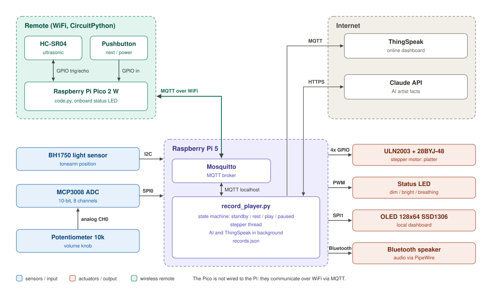

# Team Project Report: Smart Record Player

IoT Essentials 2026 · Maarten Wils / Robin Wils

> Draft. Final screenshots, self-evaluation and demo link still need to be added.

## 1. Concept

The Smart Record Player combines a physical record-player model with IoT sensors, local feedback, Bluetooth audio, RFID record selection and MQTT. The Pico 2 W handles the hardware in the model; the Raspberry Pi 5 handles the player state, audio and online services.

## 2. Information-Value Loop

| Stage | Implementation |
| --- | --- |
| Create | BH1750, HC-SR04, button, MCP3008 + potentiometer, RFID |
| Communicate | Pico 2 W -> MQTT/WiFi -> Mosquitto on Pi 5; Pi -> ThingSpeak via MQTT |
| Analyze | player state: STANDBY / REST / PLAY / PAUSED; RFID record selection |
| Act | Bluetooth audio, PWM LED, OLED, stepper motor |
| Online / extra | ThingSpeak and AI/fallback artist facts |

## 3. Architecture

Current wiring: `pinout.md`.

## 4. Verified functionality

- BH1750 lux values from Pico over MQTT
- REST / PLAY detection with `LIGHT_THRESHOLD = 4.0`
- HC-SR04 distance and TOGGLE gesture for PLAY / PAUSED
- pushbutton POWER for STANDBY / active player
- MCP3008 volume potentiometer and end-to-end Bluetooth volume control
- RC522 RFID reading for two different tags
- RFID record selection:
  - `d5293d0a` -> Emma M. Andersson - Megasong
  - `c5e63f0a` -> Al Jolson - Avalon (1920)
- MCP3008 and RFID sharing SPI0
- SPI1 OLED reacts to REST / PLAY / PAUSED and blinks in PAUSED
- PWM LED bright while active and dim in STANDBY
- 28BYJ-48 stepper runs the platter in PLAY and stops outside PLAY
- Pi starts, stops, pauses and resumes Bluetooth audio according to player state
- ThingSpeak MQTT connection and publication of state, lux, volume, distance and record number
- complete integrated flow verified in one run and recorded on video

Detailed status: `testing.md`.

## 5. Remaining before submission/demo

- visually verify the ThingSpeak web dashboard when channel access is available
- add final setup photo
- verify the final schematic against the physical build
- complete the team role table required by the assignment
- complete self-evaluation per rubric item with motivation
- add AI-use disclosure
- add final demo/video link
- optionally improve OLED information display with clearer state, artist/title and/or fact
- optionally finish LEGO appearance if time remains

## 6. Current rubric coverage

| Rubric item | Current implementation | Status |
| --- | --- | --- |
| Original concept | Smart Record Player with physical model and RFID records | BUILT |
| Digital in/out, PWM, motor, ultrasonic | button, HC-SR04, PWM LED, stepper | TESTED |
| I2C | BH1750 | TESTED |
| SPI analog + OLED | MCP3008 volume + SPI OLED | TESTED |
| MQTT via Pico | live Pico publish/subscribe | TESTED |
| Local/online dashboard | OLED tested; ThingSpeak MQTT data publish tested; web view pending | MOSTLY TESTED |
| AI / extra | fallback facts verified; external AI key optional | TESTED WITH FALLBACK |
| Presentation/demo | full integrated demo recorded in one run | DONE FOR WORKING PROTOTYPE |
| Report/video | draft present; final evidence and links still required | OPEN |

## 7. Team contribution

Both team members contribute to the complete project. Maarten leads physical hardware integration, testing and current Pico hardware migration. Robin's existing software contribution is preserved; changes are only made when required for integration.

## 8. Final items to add

- team role table required by the assignment
- complete setup photo
- final schematic confirmation
- self-evaluation per rubric item with motivation
- AI-use disclosure
- final demo/video link
